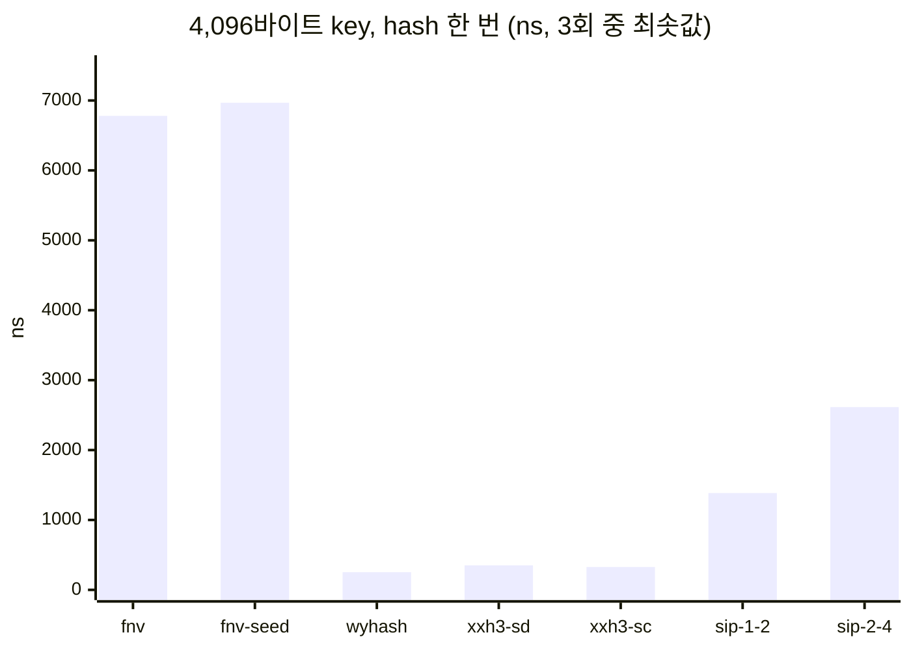

# hash 함수 로직 선택 & seed 암호화 성능 측정

## 관찰 대상

hash 함수를 바꾸면 [hash 값을 계산하는 시간]과 [key가 버킷에 흩어지는 정도가 어떻게 달라지는지] 봐요. hash 계산은 저장, 조회, 삭제의 모든 요청에서 한 번씩 일어나요. 

seed가 공격을 막는 정도는 hash 함수마다 다르므로, seed를 넣을지와 어떤 hash 함수를 쓸지를 한 실험에서 함께 정해요.

## 측정 방법

`make hash-micro`(실험 브랜치 `CJG-hash-bench`의 `scripts/bench/hash_micro.c`)로, 서버 없이 hash 함수만 불러서 재요. 세 검사는 한 번 실행할 때 모두 돌고, 처리 시간 검사만 그 안에서 3회 반복해요.

### 처리 시간

```text
시계 시작
  16바이트 key를 hash하기 16,777,216번
시계 멈춤
전체 시간 ÷ 16,777,216 = hash 한 번의 시간
```

### 평균 비교 횟수
entry에 몇 개의 key가 들어있는 지에 대한 지표입니다.

```text
예를 들어, 평균 비교 횟수가 2.0이면 GET 한 번에 entry 2개를 비교합니다.
```

### Seed에 따른 bucket 분포의 변화율

```text
seed의 bit 하나를 바꿨을 때 key 가운데 몇 %가 다른 버킷으로 옮겨 가는지를 재는 지표입니다.
```

## 결과

**결론:** SipHash 1-2를 사용합니다.

### 처리 시간 (ns, 3회 범위)

| 후보 | 16바이트 | 256바이트 | 4,096바이트 |
|---|---|---|---|
| fnv-current | 37.7\~42.5 | 441\~477 | 6,780\~7,021 |
| fnv-seed | 41.2\~42.5 | 444\~463 | 6,967\~7,131 |
| wyhash | 13.1\~16.2 | 27.4\~29.9 | 253\~259 |
| xxh3-seed | 11.8\~12.2 | 33.1\~38.0 | 351\~412 |
| xxh3-secret | 11.5\~11.8 | 32.2\~33.3 | 327\~348 |
| siphash-1-2 | 18.7\~19.4 | 90.9\~95.2 | 1,385\~1,417 |
| siphash-2-4 | 28.2\~30.2 | 182\~201 | 2,614\~2,695 |



### 버킷 분포 (버킷 2²¹개)

| 후보 | 가장 긴 버킷 | 빈 버킷 % | 평균 비교 횟수 |
|---|---|---|---|
| 무작위일 때의 기대값 | | 13.534 | 2.0000 |
| fnv-current | 10 | 12.773 | 1.9726 |
| fnv-seed | 11 | 12.735 | 1.9723 |
| wyhash | 12 | 13.552 | 2.0000 |
| xxh3-seed, xxh3-secret | 12 | 13.525 | 2.0000 |
| siphash-1-2 | 12 | 13.511 | 1.9996 |
| siphash-2-4 | 13 | 13.525 | 1.9995 |

모든 후보가 기대값 근처예요. 버킷 2²⁰개에서도 같은 모양이었어요. FNV가 기대값보다 조금 고른 것이 의미 있는 차이인지는 판단할 기준이 아직 없어요.

### seed bit 검사 (key 100,000개, 버킷 2²¹개)

| 뒤집은 seed bit | fnv-seed | wyhash, xxHash, SipHash |
|---|---|---|
| 40 | 100% 그대로 | 0% |
| 21 | 100% 그대로 | 0% |
| 20 | 0% | 0% |
| 10 | 0% | 0% |

FNV는 버킷 번호가 쓰는 bit 수(21)와 정확히 같은 자리에서 결과가 갈렸어요. seed의 bit 21 이상은 버킷 번호에 닿지 않으므로, 64 bit seed를 넣어도 공격자가 맞혀야 하는 것은 아래쪽 21 bit(약 200만 가지)뿐이에요. bit 21, 20, 10 줄은 bit 40의 결과를 의심해서 `SEED_FLIP_BIT`만 바꿔 다시 돌린 결과예요.

## 관련 ADR 및 문서

| 문서 | 이 실험과의 관계 |
|---|---|
| `src/hash.c`의 `hash_bytes` | 현재 상태의 hash 함수 |
| `src/store.c`의 `entry_hash` | store가 key 바이트만 hash하도록 정한 자리 |
| `docs/milestones/store/spec.md` Q6 | key 바이트만 hash하고 value는 hash하지 않기로 한 결정 |
| `docs/milestones/store/spec.md` "Redis와 대조"의 해시와 비교 행 | Redis가 seed를 섞는 SipHash를 쓴다고 적은 자리 |
| `README.md` "알려진 한계" | 현재 상태: key의 hash에 무작위 seed를 섞지 않는다고 적혀 있음 |
| `docs/milestones/perf/overview.md` | hash seed를 성능이 아니라 안전성 문제로 보고 perf 마일스톤 밖에 둔 결정 |
| [RFC 9923](https://www.rfc-editor.org/rfc/rfc9923.html) §1.4, §2.2, §6.1 | FNV의 최하위 bit, 비밀 offset basis가 막는 공격과 막지 못하는 공격 |
| [Redis `src/siphash.c`](https://github.com/redis/redis/blob/unstable/src/siphash.c) | Redis가 2-4 대신 1-2를 고른 이유: 2-4가 Redis를 4% 정도 느리게 했다는 주석 |
