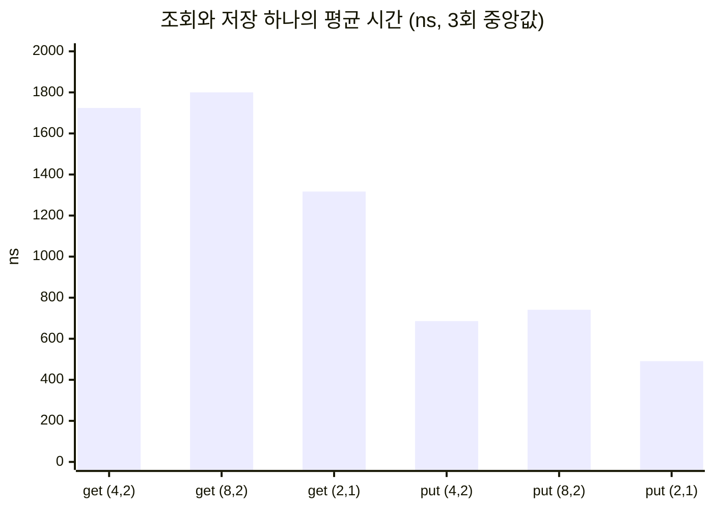
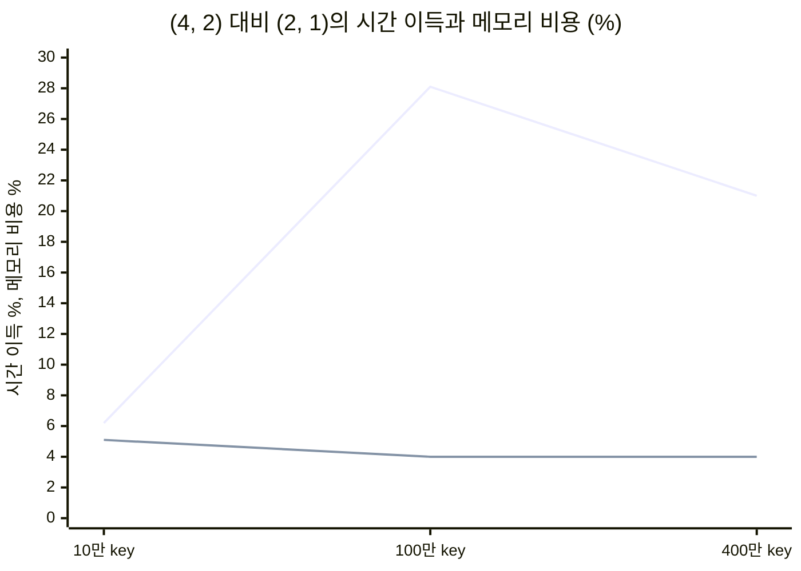
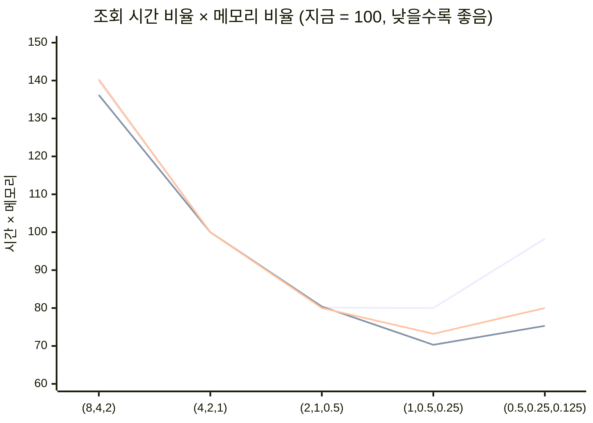

# 버킷당 entry 수의 허용 범위를 바꿀 때의 time & memory 차이 비교

## 관찰 대상

[CJG] `rehash`의 발동 조건 수정에 따른 시간 효율 vs. 메모리 비용을 검증합니다.

## 측정 방법

`make rehash-micro`(실험 브랜치 `CJG-hash-bench`의 `scripts/bench/rehash_micro.c`)로, 서버 없이 store 함수를 직접 불러서 재요. 설정마다 `src/hash.c`를 따로 빌드하고, 설정마다 3회 반복해요.

| 검사 | 하는 일 | 재는 것 |
|---|---|---|
| 저장 | `store_set`으로 `prefill-0`\~`prefill-4194303`(value 100바이트)을 차례로 넣어요 | 저장 하나의 평균 시간, 저장 하나의 최대 시간(가장 긴 rehash 멈춤) |
| 조회 | 같은 key를 무작위 순서로 `store_get`해요 | 조회 하나의 평균 시간 |
| 메모리 | 다 넣은 뒤의 버킷 수를 읽어요 | 버킷 배열 메모리(버킷 수 × `sizeof(struct list)` 32바이트) |

### key 수에 따른 시간과 메모리 효율

첫 측정에서 (2, 1)이 빨랐던 이유는 entry가 캐시에 없어서 비교 한 번이 비쌌기 때문으로 보여요. 그래서 이득의 크기는 key 수에 따라 달라질 수 있어요. (4, 2)와 (2, 1)만 두고 key 수를 바꿔서 시간과 메모리를 각자의 비율로 비교해요.

| 항목 | 내용 |
|---|---|
| 바꾸는 요인 | key 수: 100,000개, 1,048,576개, 4,194,304개. value 크기(100바이트)와 key 모양(`prefill-N`)은 고정해요 |
| 시간 이득 % | (4, 2) 대비 (2, 1)의 조회 하나 평균 시간이 줄어든 비율이에요 |
| 메모리 비용 % | (4, 2) 대비 (2, 1)에서 key 하나당 메모리가 늘어난 비율이에요. key 하나당 메모리는 다 넣은 뒤 프로세스 RSS가 늘어난 양 ÷ key 수로 재요 |
| 효율 | 시간 이득 % ÷ 메모리 비용 %예요. 1보다 크면 메모리를 낸 비율보다 시간을 더 큰 비율로 샀다는 뜻이에요 |
| 결론 규칙 | 효율이 1보다 큰 key 수에서는 (2, 1)을, 1보다 작은 key 수에서는 (4, 2)를 택해요 |
| 반복 | key 수마다 3회, 회마다 두 설정을 번갈아 실행해요 |

### 버킷당 entry 수의 최적값

(2, 1)보다 범위를 더 좁히면 비교는 더 줄지만 버킷 배열은 두 배씩 커져요. 한 단계 좁힐 때마다 얻는 시간과 내는 메모리를 바로 앞 단계와 견줘서, 어디까지 좁히는 것이 이득인지 찾아요.

| 항목 | 내용 |
|---|---|
| 설정 | (위쪽 경계, 목표, 아래쪽 경계) = (8, 4, 2), (4, 2, 1), (2, 1, 0.5), (1, 0.5, 0.25), (0.5, 0.25, 0.125). 지금 설정 (4, 2, 1)의 비율을 그대로 두고 세 값을 함께 절반씩 줄여요. 버킷당 entry는 각각 4\~8, 2\~4, 1\~2, 0.5\~1, 0.25\~0.5개 사이를 오가요. 0.5 같은 값은 `-D`로 실수를 주면 `rehash`의 곱셈과 나눗셈이 실수로 계산된 뒤 버킷 수로 잘려요 |
| key 수 | 100,000개, 1,048,576개, 4,194,304개 |
| 단계 효율 | 한 단계 좁힐 때 바로 앞 설정 대비 조회 시간 이득 % ÷ key 하나당 RSS 비용 %예요 |
| 결론 규칙 | key 수마다 단계 효율이 1보다 큰 마지막 단계가 최적이에요. 측정 뒤에 설정마다 숫자 하나로 비교하도록 "시간 × 메모리"가 가장 작은 설정을 최적으로 바꿨어요. 두 규칙은 거의 같은 답을 냈어요 |
| 반복 | key 수마다 3회, 회마다 다섯 설정을 번갈아 실행하고, 3회의 중앙값으로 계산해요 |

아래쪽 경계를 함께 줄이는 이유는, 아래쪽 경계가 위쪽 경계보다 크면 범위가 비기 때문이에요. 범위가 비면 `rehash`는 저장마다 이상적인 버킷 수를 다시 계산하는 M3 이전의 동작으로 돌아가요. 첫 시도는 아래쪽 경계를 1로 둔 채 재서 (0.5, 0.25)의 버킷이 계산의 두 배가 됐고, 그 결과는 버렸어요.

## 결과

2026-11-18, `CJG-hash-bench`의 커밋 `2297cde`에서 `make rehash-micro`로 3회 쟀어요. 회마다 세 설정을 번갈아 실행했어요. 예상을 적기 전에 잰 결과예요.

**결론:** 범위를 좁힌 (2, 1)이 저장과 조회 모두 가장 빨랐고, 그 대가로 버킷 배열 메모리가 32 MiB 늘었어요. rehash를 드물게 한 (8, 2)는 저장과 조회 모두 지금보다 느렸어요. 가장 긴 멈춤은 세 설정 모두 130\~200 ms 정도로 같았어요.

| 설정 | 저장 하나 평균 (ns) | 저장 하나 최대 (ms) | rehash 횟수 | 조회 하나 평균 (ns) | 버킷 수 | 버킷 배열 (MiB) |
|---|---|---|---|---|---|---|
| 지금 (4, 2) | 603\~816 | 126.7\~199.2 | 18 | 1,654\~1,735 | 1,048,576 | 32 |
| 드물게 (8, 2) | 722\~742 | 157.7\~160.5 | 9 | 1,787\~1,822 | 1,048,576 | 32 |
| 짧게 (2, 1) | 447\~495 | 131.3\~136.5 | 19 | 1,313\~1,321 | 2,097,152 | 64 |



- **비교 횟수가 시간을 정해요.** 버킷당 entry를 줄인 (2, 1)은 조회가 약 400 ns(약 24%) 빨라졌어요. 저장도 넣기 전에 같은 key를 버킷에서 찾으므로 함께 빨라졌어요. 에이전트는 측정 전에 비교 한 번을 최악 약 100 ns로 추정했지만, 이 측정에서는 비교 한 번이 수백 ns였어요. entry가 약 800 MB에 흩어져 있어서 비교마다 캐시에 없는 메모리를 읽기 때문으로 봐요.
- **rehash를 드물게 해도 이득이 없었어요.** (8, 2)는 rehash가 18번에서 9번으로 줄었지만, 버킷당 entry가 최대 8개까지 쌓여서 늘어난 비교 시간이 줄어든 rehash 시간보다 컸어요.
- **가장 긴 멈춤은 범위로 줄지 않아요.** 세 설정 모두 마지막 rehash가 key 2,097,153개째에서 일어나 entry 약 210만 개를 한 번에 옮겨요. 멈춤의 차이는 회마다의 흔들림과 비슷한 크기예요.
- **메모리:** (2, 1)은 버킷 배열이 32 MiB에서 64 MiB로 늘어요. entry 전체(약 800 MB)에 견주면 약 4%에서 8%로 늘어나는 셈이에요.

서버 전체에서 조회 하나가 약 400 ns 빨라지는 것이 보일지는 아직 재지 않았어요.

### key 수에 따른 시간과 메모리 효율의 결과

2026-11-18, 커밋 `9720eae`에서 `make rehash-micro REHASH_SETTINGS='4_2 2_1' REHASH_KEYS='100000 1048576 4194304'`로 3회 쟀어요. 시간은 3회의 중앙값으로 계산했어요.

**결론:**

(2, 1)이 나아요. 

| key 수 | 조회 하나 (4, 2) (ns) | 조회 하나 (2, 1) (ns) | 시간 이득 % | key 하나당 RSS (4, 2) → (2, 1) (바이트) | 메모리 비용 % | 효율 |
|---|---|---|---|---|---|---|
| 100,000 | 571\~679 | 608\~685 | 구분 안 됨 (중앙값으로는 6.2) | 203.9 → 214.3 | 5.1 | 판정 못 함 |
| 1,048,576 | 1,402\~1,670 | 1,021\~1,123 | 28.1 | 200.1 → 208.1 | 4.0 | 7.0 |
| 4,194,304 | 1,600\~1,815 | 1,351\~1,394 | 21.0 | 200.0 → 208.0 | 4.0 | 5.2 |



- **시간 이득:** 

Key가 10만개일 때
```text
entry 전체가 약 20 MB라서 CPU 캐시에 상당 부분 들어가서 이득이 잡음에 묻혀요. 
```

Key가 100만개일 때
```text
비교마다 캐시에 없는 메모리를 읽어서, 비교를 줄인 효과가 20\~28%로 드러나요.
```

- **메모리 비용:** key 하나당 늘어난 RSS(8\~10바이트)가 늘어난 버킷 배열(버킷 수 × 32바이트 ÷ key 수)과 같아요. 그래서 RSS로 잰 비용은 버킷 배열만의 비용이에요.
- **저장:** 저장 하나의 평균도 같은 모양이었어요. 100,000개에서는 범위가 겹쳤고, 1,048,576개에서 24%, 4,194,304개에서 29% 빨랐어요.

### 버킷당 entry 수의 최적값의 결과

2026-11-18, 커밋 `81fb122`에서 `make rehash-micro REHASH_SETTINGS='8_4_2 4_2_1 2_1_0.5 1_0.5_0.25 0.5_0.25_0.125' REHASH_KEYS='100000 1048576 4194304'`로 3회 쟀어요.

**결론:** 시간 × 메모리가 가장 작은 설정은 key 1,048,576개와 4,194,304개에서 (1, 0.5, 0.25)이고, key 100,000개에서는 (2, 1, 0.5)와 (1, 0.5, 0.25)가 같아요. 다만 (1, 0.5, 0.25)는 가장 긴 rehash 멈춤을 key 4,194,304개에서 약 30% 늘려요. 이 지표는 멈춤을 셈에 넣지 않았어요. 이 측정을 바탕으로 (1, 0.5, 0.25)를 쓰기로 했어요(2026-11-18). 이후 서버 측정에서 멈춤이 길어지는 원인이 새 버킷 배열의 초기화로 확인되어 (2, 1, 0.5)로 바꿨어요. 그 경위는 팀 레포의 `docs/milestones/perf/ideas/rehash-thresholds.md` "결정"에 있어요. 멈춤이 약 30% 늘어나는 것은 받아들이고, 멈춤을 줄이는 나눠 옮기기(`rehash-incremental.md`)는 보류했어요. 경계 근처에서 저장과 삭제가 번갈아 오는 경우는 아직 재지 않았어요.

설정마다 `조회 시간 비율 × 메모리 비율`을 계산했어요. 두 비율 모두 지금 설정 (4, 2, 1)의 값을 100으로 둔 것이고, 조회 시간은 3회의 중앙값, 메모리는 key 하나당 RSS예요. 시간도 짧고 메모리도 적을수록 작아지므로, 가장 작은 설정이 메모리 대비 시간 효율이 가장 좋은 설정이에요. 이 지표는 시간 1%와 메모리 1%를 같은 값으로 친다고 가정해요. 메모리가 더 귀한 환경이면 최적 설정이 (2, 1, 0.5) 쪽으로 옮겨 가요.

| 설정 | 10만 key | 100만 key | 400만 key |
|---|---|---|---|
| (8, 4, 2) | 139.8 | 136.2 | 140.3 |
| (4, 2, 1) 지금 | 100 | 100 | 100 |
| (2, 1, 0.5) | **80.1** | 80.4 | 80.0 |
| (1, 0.5, 0.25) | **80.0** | **70.3** | **73.2** |
| (0.5, 0.25, 0.125) | 98.3 | 75.3 | 80.0 |



선이 가장 낮은 지점이 그 key 수의 최적 설정이에요. 계산에 쓴 두 비율은 이래요.

| 설정 | 조회 시간 비율, 10만 / 100만 / 400만 key | 메모리 비율, 10만 / 100만 / 400만 key |
|---|---|---|
| (8, 4, 2) | 143.5 / 139.0 / 143.2 | 97.4 / 98.0 / 98.0 |
| (4, 2, 1) 지금 | 100 / 100 / 100 | 100 / 100 / 100 |
| (2, 1, 0.5) | 76.2 / 77.3 / 76.9 | 105.1 / 104.0 / 104.0 |
| (1, 0.5, 0.25) | 69.3 / 62.8 / 65.4 | 115.4 / 112.0 / 112.0 |
| (0.5, 0.25, 0.125) | 72.3 / 58.8 / 62.5 | 136.0 / 128.0 / 128.0 |

처음 설계한 단계 효율은 이웃한 두 설정끼리 견준 값이에요(바로 앞 설정 대비 조회 시간 이득 % ÷ 메모리 비용 %). 단계 효율이 1보다 크면 그 단계에서 시간 × 메모리도 대체로 줄어들어서, 두 규칙은 거의 같은 답을 내요. 10만 key의 (2, 1, 0.5) → (1, 0.5, 0.25) 단계만 단계 효율이 0.93인데 시간 × 메모리는 80.1에서 80.0으로 같은 수준이에요.

| 좁히는 단계 | 10만 key | 100만 key | 400만 key |
|---|---|---|---|
| (8, 4, 2) → (4, 2, 1) | 11.36 | 13.74 | 14.79 |
| (4, 2, 1) → (2, 1, 0.5) | 4.66 | 5.67 | 5.77 |
| (2, 1, 0.5) → (1, 0.5, 0.25) | 0.93 | 2.45 | 1.95 |
| (1, 0.5, 0.25) → (0.5, 0.25, 0.125) | −0.24 | 0.43 | 0.31 |

| 설정 | 조회 하나 중앙값, 10만 key (ns) | 100만 key (ns) | 400만 key (ns) | key 하나당 RSS, 400만 key (바이트) | 가장 긴 멈춤, 400만 key (ms) |
|---|---|---|---|---|---|
| (8, 4, 2) | 1,009 | 2,090 | 2,614 | 196.0 | 140.4\~150.0 |
| (4, 2, 1) 지금 | 703 | 1,504 | 1,825 | 200.0 | 128.8\~141.4 |
| (2, 1, 0.5) | 536 | 1,163 | 1,404 | 208.0 | 133.7\~143.0 |
| (1, 0.5, 0.25) | 487 | 944 | 1,193 | 224.0 | 174.6\~179.7 |
| (0.5, 0.25, 0.125) | 508 | 885 | 1,140 | 256.0 | 254.6\~259.3 |

조회 시간이 줄다가 평평해지는 이유는 평균 비교 횟수로 읽을 수 있어요. 찾는 key 자신과의 비교 1번은 빼낼 수 없으므로, 범위를 좁힐수록 줄어드는 비교가 점점 작아져요. 평평해지는 지점은 key 10만 개에서는 (2, 1, 0.5) 뒤, key 100만 개와 400만 개에서는 (1, 0.5, 0.25) 뒤예요.

| 설정 | 버킷당 평균 entry | 평균 비교 횟수 (1 + 평균 ÷ 2) |
|---|---|---|
| (4, 2, 1) | 2\~4 | 2\~3 |
| (2, 1, 0.5) | 1\~2 | 1.5\~2 |
| (1, 0.5, 0.25) | 0.5\~1 | 1.25\~1.5 |
| (0.5, 0.25, 0.125) | 0.25\~0.5 | 1.125\~1.25 |

key 하나당 RSS는 key를 넣기 전과 다 넣은 뒤의 프로세스 RSS 차이를 key 수로 나눈 값이에요. 그 가운데 지금 버킷 배열의 몫(버킷 수 × 32바이트 ÷ key 수)을 빼면 나머지가 모든 설정에서 192바이트로 같아요. 버킷 하나(`struct list`)는 head와 tail 두 칸이라 32바이트예요.

| 설정 | key 하나당 RSS, 400만 key (바이트) | 지금 버킷 배열 몫 | 나머지 |
|---|---|---|---|
| (8, 4, 2) | 196.0 | 4 | 192 |
| (4, 2, 1) 지금 | 200.0 | 8 | 192 |
| (2, 1, 0.5) | 208.0 | 16 | 192 |
| (1, 0.5, 0.25) | 224.0 | 32 | 192 |
| (0.5, 0.25, 0.125) | 256.0 | 64 | 192 |

그래서 설정이 바꾸는 메모리는 버킷 배열뿐이에요. 처음에는 버킷을 16바이트로 잘못 계산해서 나머지가 설정마다 다르다고 보고 "malloc이 이전 배열을 들고 있다"고 추론했는데, 32바이트로 다시 계산하니 그 추론은 틀렸어요.

- **좁힐수록 시간 이득은 줄고 메모리 비용은 커져요.** 한 단계마다 버킷 배열이 두 배가 되므로 메모리 비용 %가 2.0, 4.0, 7.7, 14.3으로 늘고, 시간 이득은 버킷당 entry가 1개 아래로 내려가면 거의 남지 않아요.
- **key 10만 개에서 (2, 1, 0.5)를 (1, 0.5, 0.25)로 좁히는 단계의 효율은 0.93이고, 두 설정의 조회 시간 범위가 겹쳤어요.** 그래서 (2, 1, 0.5)를 최적으로 봤어요.
- **멈춤은 좁힐수록 길어져요.** 아래 "가장 긴 멈춤"에 따로 적었어요.
- **이 측정은 저장과 조회만 해요.** 경계 근처에서 저장과 삭제가 번갈아 오는 경우(003의 C)는 재지 않았어요.

#### 가장 긴 멈춤

가장 긴 멈춤은 store_set 한 번에 걸린 시간 가운데 가장 긴 값이에요. 버킷을 늘리는 rehash를 일으킨 store_set은 entry를 모두 옮길 때까지 돌아오지 않고, 서버는 스레드 하나로 모든 요청을 처리하므로 그동안 다른 client의 GET도 모두 기다려요. 005 E에서 작은 GET p99가 수백 ms로 튄 것이 이 멈춤이에요.

key 400만 개에서는 다섯 설정 모두 가장 큰 rehash가 key 2,097,153개째에서 일어나서, 옮기는 entry 수(약 210만 개)가 같아요. 그런데도 좁힐수록 멈춤이 길어진 이유는, rehash가 entry를 옮기기 전에 새 버킷 배열을 할당하고 버킷마다 빈 리스트로 초기화하는데 그 배열이 한 단계마다 두 배로 커지기 때문으로 봐요.

| 설정 | 마지막 rehash가 새로 만드는 버킷 배열 | 가장 긴 멈춤, 400만 key (ms) |
|---|---|---|
| (4, 2, 1) 지금 | 1,048,576개 (32 MiB) | 128.8\~141.4 |
| (2, 1, 0.5) | 2,097,152개 (64 MiB) | 133.7\~143.0 |
| (1, 0.5, 0.25) | 4,194,304개 (128 MiB) | 174.6\~179.7 |
| (0.5, 0.25, 0.125) | 8,388,608개 (256 MiB) | 254.6\~259.3 |

(2, 1, 0.5)까지는 배열을 초기화하는 시간이 entry 210만 개를 옮기는 시간에 비해 작아서 멈춤이 거의 같고, 그 뒤로는 배열이 커지는 몫이 드러나요. 이 해석은 배열 크기와 멈춤이 함께 커진다는 데서 나온 추론이고, 두 시간을 따로 재지는 않았어요.

## 관련 ADR 및 문서

| 문서 | 이 실험과의 관계 |
|---|---|
| `src/hash.c`의 `rehash` | M3에서 범위 안이면 버킷 수를 바꾸지 않도록 고친 자리 |
| `docs/measurements/server/003-DA-slower-rehash.md` C | 범위를 둔 뒤 경계에서 저장과 삭제를 반복해도 작은 GET p99가 0.2 ms 아래로 내려간 기록 |
| `docs/milestones/concurrency/spec.md` "측정 결과" | 범위가 없을 때 경계에서 요청마다 entry 전부를 옮긴 기록 |
